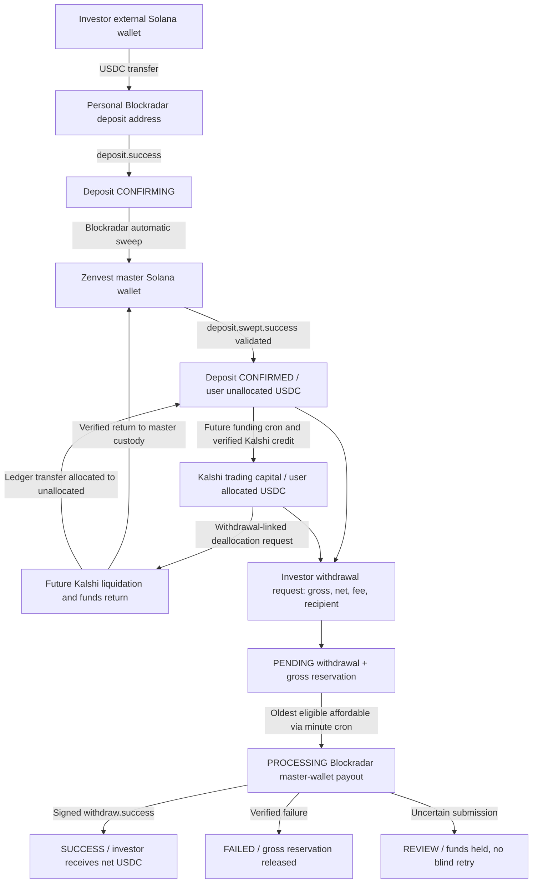

# Zenvest — USDC Funds Lifecycle and Treasury System Design

**Status:** Living internal architecture reference  
**Scope:** Solana USDC deposits, treasury custody, Kalshi capital allocation/deallocation, withdrawal requests, automated payouts, reconciliation, and investor UI.  
**Implementation reference:** [PR #30](https://github.com/en0ma/zenvest/pull/30) (unmerged at drafting).  
**Audience:** Engineering, treasury operations, and future integration work.  
**Not website documentation.** This Markdown file is maintained in the repository for internal design review.

## 1. Purpose and boundaries

Zenvest's application database is the **investor ownership and liability ledger**. Blockradar handles Solana deposit addresses, sweeping and master-wallet payouts. Kalshi will hold trading capital when funded; **Kalshi funding/deallocation APIs and a master-to-Kalshi funding cron are future work**. A ledger record is not proof that USDC exists on-chain or is currently spendable.

Principles:

1. An inbound deposit is not credited as available until a verified sweep reaches the configured master wallet.
2. Investors may request gross withdrawals against **allocated + unallocated − pending withdrawals**, regardless of whether funds are at Kalshi or in master custody.
3. Accepting a withdrawal reserves the **gross** amount by increasing pending withdrawals; it does **not** move allocated/unallocated balances.
4. If existing unallocated capital does not cover outstanding pending withdrawals, create a **linked deallocation obligation** for the incremental shortfall.
5. Confirmed Kalshi deallocation and Blockradar payout are **independent** operations. Confirmed deallocation moves allocated → unallocated; payout failure does not undo it.
6. Pay out only when actual, reconciled master-wallet liquidity is sufficient. Protect against double submits, concurrent crons, webhook duplicates, and ambiguous provider results.
7. Keep a fixed **2 USDC fee** per successful withdrawal. The investor enters gross; recipient receives net = gross − fee. The fee remains an operating treasury reserve, not a native SOL gas payment.

## 2. System map



The two directions between master custody and Kalshi are separate pipelines: **master → Kalshi allocation** is future work; **Kalshi → master deallocation** is future work. A database balance change must follow verified funding or return, not precede it.

## 3. Accounting model and invariants

For each investor, in integer micro-USDC:

- `A = allocatedUsdcMicros` — user's capital recorded as allocated to trading.
- `U = unallocatedUsdcMicros` — user's capital recorded as unallocated.
- `P = pendingWithdrawalsUsdcMicros` — **gross** amounts reserved by accepted withdrawals awaiting final success/failure.
- **`AvailableToWithdraw = max(0, A + U - P)`**.
- **`GrossWithdrawal = NetPayout + 2_000_000 micros`**.
- Deposit funding first enters `pendingDepositsUsdcMicros`, then `U` upon verified sweep.

**Do not decrement A or U at request creation.** Increment P instead. On success, decrement P by gross, then debit gross from U first and any remainder from A. On definitive payout failure, decrement P only. Investor-initiated cancellation is unsupported.

On **verified deallocation completion**, decrement A and increment U by the completed amount, preserving `A + U` and leaving P unchanged. If a subsequent payout fails, the returned funds **remain unallocated**.

### Example: allocation-sensitive withdrawal

| Event | A | U | P | Available |
|---|---:|---:|---:|---:|
| Initially | 700 | 300 | 0 | 1,000 |
| Request gross 500 (net 498) | 700 | 300 | 500 | 500 |
| Complete 200 deallocation | 500 | 500 | 500 | 500 |
| Payout definitively fails | 500 | 500 | 0 | 1,000 |

All numbers are USDC; the example excludes concurrent trades and other transactions.

### Multiple pending withdrawals and incremental deallocation

New request gross `G`, with pre-request pending `P` and unallocated `U`:

```text
oldShortfall = max(0, P - U)
newShortfall = max(0, P + G - U)
newDeallocationObligation = newShortfall - oldShortfall
```

Example: U = 300, P = 100, new G = 500 → shortfall grows from 0 to 300; the new withdrawal triggers a **300 USDC** deallocation request. A previous pending request may already consume some of U. This calculation is a **snapshot** and requires recalculation/reconciliation when requests are cancelled, deallocations finish, trades settle, or withdrawals complete in a different order.

### Master wallet balance model

`MasterWalletBalance` currently holds:

- `confirmedUsdcMicros`: event-derived master USDC (sweep credits less successful payouts).
- `reservedUsdcMicros`: net payouts reserved while being processed.
- `feeReserveUsdcMicros`: retained 2 USDC successful withdrawal fees.
- Candidate spendable master liquidity = confirmed − reserved − fee reserve.

**Caution:** this is an accounting table, *not* automatically an authoritative on-chain balance. It starts at zero and omits historical funds, transfers outside Zenvest, Kalshi returns unless integrated, and treasury adjustments. Before enabling payouts, bootstrap and continuously reconcile against the master wallet's real USDC token balance; also separately fund the native SOL needed for sweeping and payouts.

## 4. Deposit cycle

### Investor UI

- Wallet shows the user's personal Solana USDC deposit address, copy action and QR code.
- Deposit history shows `CONFIRMING` and `CONFIRMED` separately.
- Confirming deposits are **visible**, but unavailable for allocation or withdrawal.
- Once confirmed, the amount increases the user's unallocated balance.

### Webhook and background processing

1. Investor transfers USDC to their registered deposit address.
2. Blockradar sends a signed `deposit.success` event. Zenvest verifies HMAC, network, USDC mint/decimals, amount, transaction and registered address; stores `BlockchainDeposit(status=CONFIRMING)`; increments pending deposits but **does not credit U**.
3. Blockradar automatically sweeps USDC to the configured master wallet.
4. Signed `deposit.swept.success` is validated against deposit identity, sweep hash, amount, sender and master-wallet recipient.
5. In a single idempotent database transaction, transition `CONFIRMING → CONFIRMED`, decrement pending deposits, increment user deposited and U, and increment accounted master USDC.
6. On `deposit.swept.failed`, do not credit; investigate or safely retry the sweep. Duplicate/out-of-order notifications must not double-credit.
7. **Required future recovery:** reconcile stale CONFIRMING deposits against Blockradar/on-chain state when webhooks are missed.

A successful sweep funds master custody; it does **not** mean funds have been sent to Kalshi.

## 5. Master → Kalshi allocation cycle (future)

A separate **future** funding scheduler will decide what legitimately unallocated capital to deploy from master custody to Kalshi. It must:

1. Exclude pending withdrawal claims, master payout reservations, fee reserves and other trading/treasury liabilities.
2. Respect risk policy, investment mandates and whether pending deallocations need liquidity first.
3. Aggregate funding intentions, issue the actual supported Kalshi funding transfer, and persist an idempotent transfer record.
4. Independently verify Kalshi has credited the funds and reconcile both custodians.
5. **Only after verification**, decrease user U, increase user A, and update treasury custody balances.

Kalshi API support, funding rails, transfer reconciliation, capital allocation policy, positions/settlement constraints, and this cron are **not yet implemented**. Do not infer that a proposed Kalshi API can transfer directly to/from a Solana address without validating its actual rails.

## 6. Withdrawal request cycle

### Investor UI

The Withdrawals page shows **Allocated**, **Unallocated**, **Pending withdrawals**, and **Available to withdraw = A + U − P**.

The form asks for:
- Gross amount in USDC;
- **Recipient Solana wallet address**.

While editing, it checks gross > 2 USDC, gross <= currently displayed available, and Solana address syntax; it previews:
- Gross deduction;
- Fixed 2 USDC fee;
- Net recipient payout;
- Whether the request will trigger additional deallocation and the **estimated incremental deallocation amount**.

The Request button is disabled for invalid input or an in-progress submit. Displayed balances/estimates are snapshots; backend validation is authoritative.

### Backend acceptance

1. Authenticate user; require feature flag.
2. Parse USDC using integer micros (no floating-point money), validate Solana destination syntax, minimum gross and unique request key.
3. Use a per-user idempotency key. Same key and same request returns the existing record; same key and different data conflicts. Unique database constraint `(userId, idempotencyKey)` defends against race/retry duplicates.
4. In a serializable transaction, calculate A + U − P, conditionally reserve **gross** by increasing P, create one `InvestorWithdrawal(status=PENDING)`, and create a linked `WithdrawalDeallocation(status=PENDING)` if incremental Kalshi return is necessary.
5. **Do not change A or U** at this stage. Concurrent requests must not over-reserve the same capital.
6. Preserve `grossUsdcMicros`, `amountUsdcMicros` (net), `feeUsdcMicros`, `asset=USDC`, destination, user/portfolio, status, timestamps, idempotency key, later Blockradar transaction ID and chain hash.
7. The withdrawal table **is the queue**. Multiple independent pending requests are permitted within the remaining A + U − P.

UI history shows pending/processing/success/failed/review statuses, net, gross, fee, destination and transaction metadata. An accepted request does **not** promise immediate payout.

## 7. Deallocation cycle: Kalshi → master (future integration)

If a new withdrawal causes pending claims to exceed unallocated capital, insert `WithdrawalDeallocation` with **mandatory, unique `withdrawalId` foreign key** and the incremental required USDC. Statuses: `PENDING → PROCESSING → COMPLETED` (or FAILED on a failed/cancelled obligation).

### Deallocation UI

Separate from withdrawal history, show each deallocation's:
- Amount of USDC requested from allocated capital;
- Its own status;
- Creation/completion timestamps;
- **Exact triggering withdrawal ID**;
- Current status of that associated withdrawal.

A withdrawal's payout may fail **after the Kalshi deallocation completed**. The deallocation remains COMPLETED and its funds remain unallocated; there is no automatic reallocation on payout failure.

### Background/cron (current vs future)

**Current** `GET /api/internal/process-deallocations` is CRON_SECRET-protected and scheduled once per minute. It **only aggregates/logs** pending deallocation count and total. It does **not** use Kalshi credentials, issue transfers or mark rows completed.

**Future** Kalshi worker should:

1. Aggregate pending deallocation obligations across users subject to Kalshi's actual available/withdrawable capital and liquidity constraints, including open positions or pending settlements.
2. Safely claim work (unique transfer references, locking and no blind retries), then transition to PROCESSING only once a legitimate operation begins.
3. Execute the supported release/withdrawal/funding rail and record provider IDs.
4. Wait for verified credit of USDC back to master custody and update/reconcile master treasury accounting.
5. Idempotently mark the corresponding deallocation COMPLETED and transfer user ledger **A → U**; pending withdrawal P does not change.
6. Permit linked withdrawal payout only once its deallocation obligations are complete **and** master-wallet USDC is sufficient.

An internal server-only helper `confirmWithdrawalDeallocation(id)` already performs the idempotent accounting movement for a PROCESSING record. It is a future **verified integration boundary**, not permission to assume a transfer took place.

If the external operation is uncertain, do not mark completed or fabricate liquidity. A payout failure should release P without reversing a completed deallocation.

## 8. Automated payout cycle

A Vercel CRON_SECRET-protected worker at `GET /api/internal/process-withdrawals` runs **each minute** (requires appropriate Vercel scheduling plan).

1. Scan pending withdrawals ordered by request creation time and ID; current implementation examines up to the oldest 100.
2. Exclude withdrawals whose linked deallocation obligation is not completed.
3. Select **the oldest eligible pending withdrawal that the master wallet can cover** using spendable master USDC. A larger unfundable older request may wait while a smaller later request proceeds.
4. In a Serializable transaction, atomically claim the request `PENDING → PROCESSING` and reserve its **net** USDC against master wallet liquidity, preventing concurrent cron spending.
5. Check Solana native fee availability through the supported Blockradar fee-estimate API; if insufficient **before broadcast**, safely release the claim and requeue.
6. Submit the **net** amount to the recipient via the Blockradar master-wallet withdrawal API using an immutable reference `zenvest-withdrawal:<withdrawalId>`.
7. If provider submission is ambiguous, mark `REVIEW` and **hold reservations** pending reconciliation; never blindly retry.
8. On a signed, validated `withdraw.success` webhook, idempotently mark SUCCESS, release master payout reservation, decrease accounted master USDC by **net**, increase retained fee reserve by 2 USDC, decrement user P by **gross**, and debit gross from U first (then A only if needed).
9. On verified payout failure/cancellation, mark FAILED, release reserved master net USDC and user pending **gross**, but **do not reverse completed Kalshi deallocations**.
10. Handle duplicate and out-of-order webhooks without a second ledger debit.

**Important ledger requirement for production:** Any already confirmed A→U deallocation should mean the gross payout is normally coverable from U once master funds are received. If the payout still needs to debit A, reconcile why; do not pay from assets that remain inaccessible on Kalshi.

## 9. State diagrams

### Deposits

```text
deposit.success          => CONFIRMING  (pending deposit; no available credit)
deposit.swept.success    => CONFIRMED   (sweep verified; credit U and master)
deposit.swept.failed     => CONFIRMING  (investigate / safe retry)
```

### Withdrawals

```text
request accepted          => PENDING    (reserve gross in P)
cron claims / submits     => PROCESSING (reserve net master liquidity)
signed withdraw.success   => SUCCESS    (ledger settlement; fee retained)
signed withdraw.failed    => FAILED     (release P; preserve completed deallocation)
user cancellation request  => REJECTED (HTTP 410; no ledger mutation)
ambiguous provider response => REVIEW (no blind retry)
```

### Deallocations

```text
withdrawal shortfall creates row => PENDING
future Kalshi transfer begins    => PROCESSING
verified return to master        => COMPLETED (A -= amount; U += amount)
known failure / safe cancellation => FAILED
```

## 10. Exception and reconciliation scenarios

| Scenario | Expected behavior |
|---|---|
| Deposit webhook arrives before sweep | Show confirming, no U credit. |
| Sweep notification arrives before deposit notification | Use validated deposit identity to record and confirm once. |
| Duplicate deposit/sweep webhook | No second deposit/master credit. |
| User sends two independent withdrawal requests | Accept each if A + U − P permits; reserve both in P. |
| Same withdrawal submitted twice with same key | Return original; do not reserve twice. |
| Requests race for remaining balance | Serializable/conditional transaction avoids over-reserving. |
| Withdrawal depends on Kalshi deallocation | Linked obligation visible; block payout until verified completion. |
| Deallocation finishes, payout subsequently fails | Keep A→U movement; release P; deallocation stays COMPLETED. |
| Master USDC is insufficient | Keep request pending; worker may pay oldest **fundable** candidate. |
| Missing or delayed payout-success webhook | Keep PROCESSING/REVIEW, reconcile provider status; never rebroadcast blindly. |
| Definite payout failure | Return gross to available via P release, no fee collected. |
| Failed pending deallocation | Keep audit record rather than deleting history. |
| Missing sweep webhook | Reconcile actual deposit/sweep status before credit. |
| Master wallet receives outside transfers | Reconcile live on-chain holdings to event-derived balance, do not invent credits. |
| Native SOL balance low | Hold payout; fund network fees before broadcast. |

## 11. Current implementation vs future work

| Component | State |
|---|---|
| Wallet address and QR UI | Implemented |
| Signed Blockradar deposit and sweep handlers | Implemented in PR |
| Deposit CONFIRMING → CONFIRMED accounting | Implemented in PR |
| Withdrawal balances, fee/net preview, Solana destination | Implemented in PR |
| Deallocation warning before withdrawal submit | Implemented in PR |
| Gross withdrawal reservation, multiple requests and idempotency | Implemented in PR |
| Withdrawal table as payout queue | Implemented in PR |
| Master-wallet accounting and one-minute payout worker | Implemented in PR, **not production-ready** |
| Separate deallocation table with triggering withdrawal ID and UI history | Implemented in PR |
| Deallocation aggregate-only cron | Implemented in PR |
| Idempotent ledger helper for completed deallocation | Implemented, not wired to Kalshi |
| Actual Kalshi trading-capital deallocation and custody return | **Not implemented** |
| Master-wallet → Kalshi allocation scheduler and transfers | **Not implemented** |
| Accurate historical master-balance bootstrap and independent ongoing reconciliation | **Not implemented** |
| Deallocation-obligation recalculation after settlement or reordering | **Not implemented** |
| End-to-end real Devnet payout and sweep verification | **Required before enabling** |
| Treasury safeguards: limits, compliance, MFA, alerts, liquidity controls | **Required before live funds** |

## 12. Required design decisions and safety gates

1. **Deallocation obligation rebasing:** Per-withdrawal incremental shortfalls can become stale successful withdrawals settle out of order, allocation/trading balances change, or existing deallocations complete. Add a locked, auditable recalculation/reconciliation process before sending Kalshi requests.
2. **Trading available balance:** Kalshi cash available for withdrawal can differ from allocated capital because of open positions, fills, fees, settlement and P&L. Release only verified withdrawable funds, not nominal A.
3. **Treasury truth:** Reconcile actual Blockradar/Solana master USDC and SOL regularly, bootstrap historic assets, account for future Kalshi inflows/outflows, and preserve fee earmarks.
4. **Webhook reality:** Test genuine Blockradar Solana Devnet payloads and delayed/out-of-order deliveries, reconcile missing events and ambiguous transfers.
5. **No double send:** Retain immutable payout references, idempotent provider behavior where supported, single-claim database transactions, and manual incident handling of uncertain outcomes.
6. **Custody vs accounting timing:** Do not set a Kalshi deallocation COMPLETED or increase master spendable USDC until verified custody receipt. Do not consider a deposit spendable until sweep confirmation.
7. **User protection:** Apply withdrawal limits, abuse/rate controls, destination validation, compliance measures and account security review before turning on automatic real-funds payouts.
8. **Scheduler:** Confirm Vercel plan supports minute cron; secure endpoints via CRON_SECRET, monitor failures and alert on stuck statuses.
9. **Feature gates:** Keep `BLOCKRADAR_WITHDRAWALS_ENABLED` off until migrations, Devnet tests and reconciliation are complete. PR #30 remains unmerged until separately approved.

## 13. Implementation pointers

- `prisma/schema.prisma` and `prisma/migrations/` — ledger and queue models.
- `src/app/wallet/page.tsx` — investor deposit view.
- `src/app/withdrawals/page.tsx`, `src/components/withdrawal-actions.tsx` — investor balances, form, history, deallocation notice.
- `src/app/api/webhooks/blockradar/route.ts` — signature verification and deposit/sweep dispatch.
- `src/lib/withdrawal-webhook.ts` — payout webhook settlement.
- `src/app/api/withdrawals/route.ts`, `src/app/api/withdrawals/cancel/route.ts` — request/cancellation.
- `src/app/api/internal/process-withdrawals/route.ts` — FIFO-ish oldest-fundable payout worker.
- `src/app/api/internal/process-deallocations/route.ts` — aggregate-only Kalshi deallocation monitor.
- `src/lib/withdrawal-deallocation.ts` — idempotent **verified** A→U transition.
- `vercel.json` — cron schedules.

**Change-control note:** This document describes the *agreed target cycle*, marks future integrations explicitly, and references an unmerged implementation PR. It is not evidence of safe production operations. Keep it updated alongside future Kalshi, reconciliation, and payouts changes.

## Policy update — non-cancelable withdrawal requests

Once accepted, investor withdrawal requests **cannot be cancelled**. The UI does not offer a cancel action, and the prior cancellation endpoint returns HTTP 410 without modifying balances or request status. A definitive failed payout can still release the gross pending reservation through the verified settlement path. This supersedes any earlier references to user cancellation in this document.
